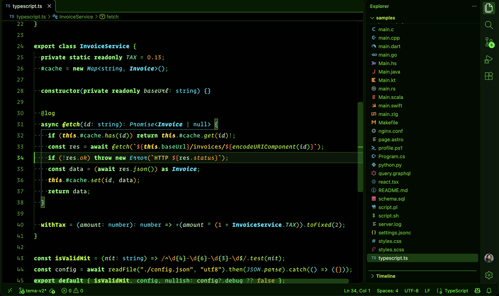
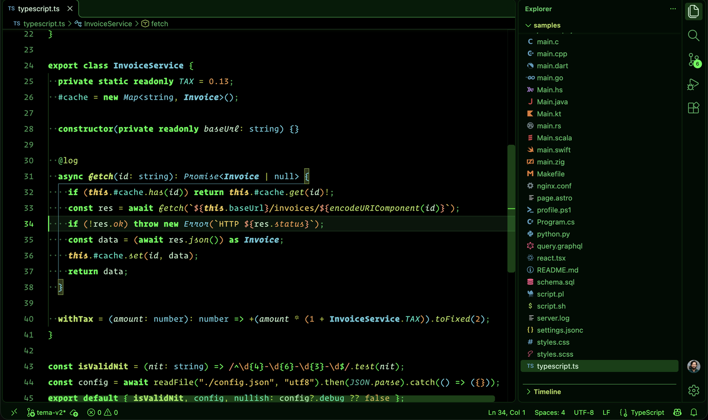
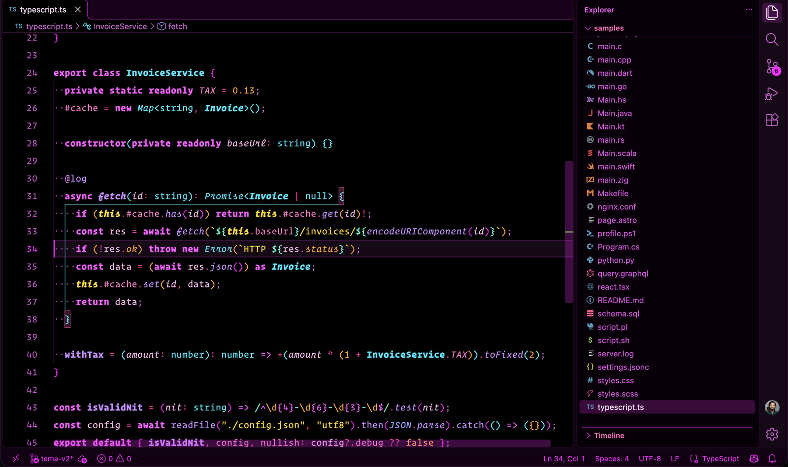
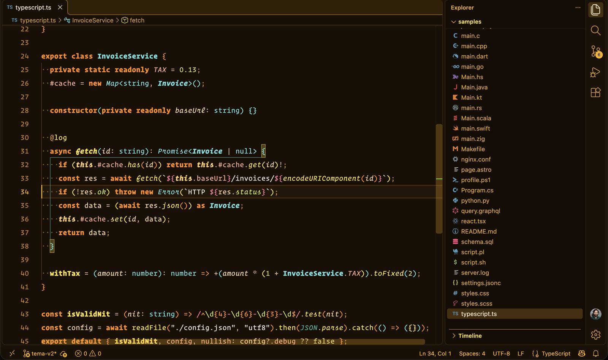
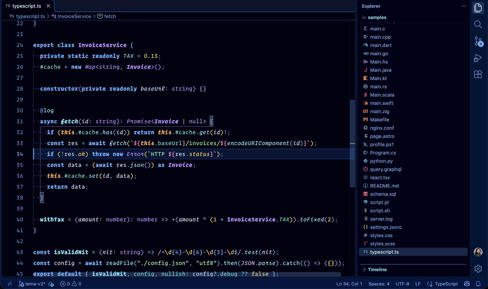

# Retro Hacker Theme for VS Code

[](https://marketplace.visualstudio.com/items?itemName=devxi.retro-hacker-theme)
[](https://marketplace.visualstudio.com/items?itemName=devxi.retro-hacker-theme)
[](https://marketplace.visualstudio.com/items?itemName=devxi.retro-hacker-theme)

Phosphor CRT terminals, neon on black, old-school hacker movies — rebuilt as a complete, modern VS Code theme.
Five variants, every one designed so you can tell **keywords, functions, types, variables, properties, strings, numbers and comments apart at a glance**, without losing the monochrome terminal vibe.



## What's new in 2.0

- **Every surface themed.** ~690 workbench colors per variant (up from ~220): suggest widget, peek view, diff and merge editors, inline chat, testing, SCM graph, notebooks, debug, sticky scroll, inlay hints… No stray default grays or blues.
- **One color per role.** Syntax colors were consolidated into a named palette with a job for each color. Near-identical greens are gone; plain text and strings no longer share a color.
- **Purposeful accents that stay hacker.** Amber for numbers/constants and warnings, cyan for types and links, ember for regex and escapes — and **red only means errors, deleted lines or invalid code.**
- **Semantic highlighting with modifiers.** Declarations in bold, `readonly`/constants, standard library, `deprecated` (strikethrough), `self`/`this`, type parameters and more.
- **Readable diffs, logs and Markdown.** Inserted vs deleted lines, `INFO` / `WARN` / `ERROR` log levels, headings, links, inline code and quotes each get their own style.
- **A real 16-color terminal.** The ANSI palette now has 8 distinguishable hues, so `ls --color`, `git`, `htop` and other TUIs look right.
- **Accessible contrast.** Text ≥ 4.5:1 and UI glyphs ≥ 3:1 against their real backgrounds, checked automatically for every variant (a few documented exceptions, like underlined errors over the selection).

## Variants

| Variant | Vibe |
|---|---|
| **Retro Hacker Green** | The flagship: phosphor-green UI, code in gold on black |
| **Retro Hacker Green - Subtle** | Calmer matrix green on pure black, softer accents for long sessions |
| **Retro Hacker Pink** | Neon magenta on black, synthwave hacker |
| **Retro Hacker Amber** | Amber phosphor CRT on warm near-black |
| **Retro Hacker Blue** | Cold blue phosphor on navy-black, IBM terminal feel |

### Retro Hacker Green


### Retro Hacker Green - Subtle


### Retro Hacker Pink


### Retro Hacker Amber


### Retro Hacker Blue


## Installation

1. Open the Extensions view (`Ctrl+Shift+X` / `Cmd+Shift+X`)
2. Search for **Retro Hacker Theme**
3. Click **Install**
4. Pick a variant: `Ctrl+K Ctrl+T` (`Cmd+K Cmd+T` on macOS)

Or install it from the [VS Code Marketplace](https://marketplace.visualstudio.com/items?itemName=devxi.retro-hacker-theme).

## Palette

### Retro Hacker Green

| Role | Color | Hex |
|---|---|---|
| Plain text | Soft gold | `#F2E6A0` |
| Strings | Gold | `#FFD700` |
| Keywords, tags | Mint | `#66FF66` |
| Functions | Lime | `#AAFF00` |
| Types, classes, links, info | Cyan | `#00E5FF` |
| Namespaces, type parameters | Teal | `#2EC4B6` |
| Variables, parameters | Pale green | `#B8F5B8` |
| Properties, attributes, imports | Spring green | `#00FA9A` |
| Numbers, constants, warnings | Amber | `#FF9F1C` |
| Regex, escapes, interpolation | Ember | `#FF6F3C` |
| Comments | Olive (italic) | `#7A9E3A` |
| Operators | Sea green | `#3CB371` |
| Errors, deleted, invalid | Red | `#FF3B3B` |
| UI accent | Phosphor | `#00FF00` |

### Other variants (main syntax roles)

| Role | Green - Subtle | Pink | Amber | Blue |
|---|---|---|---|---|
| Background | `#000000` | `#010001` | `#1A1006` | `#010111` |
| Plain text | `#7CE896` | `#F4DCEF` | `#FFB000` | `#E4ECFF` |
| Keywords | `#00FF41` | `#FF55FF` | `#FF8C1A` | `#5EAFFF` |
| Functions | `#B4E05C` | `#C88CFF` | `#FFE14D` | `#7FE9FF` |
| Types | `#62C9D9` | `#00E5FF` | `#6FE0E0` | `#B98CFF` |
| Variables | `#BCE8C4` | `#FFB8EC` | `#FFD49C` | `#C8DCFF` |
| Properties | `#2EDCBC` | `#FF79C6` | `#FFAD8C` | `#3FE0C5` |
| Strings | `#E6C450` | `#FFD700` | `#F2EDD6` | `#8EF0A0` |
| Numbers | `#E8964A` | `#FF9F1C` | `#D2D66A` | `#FFD24A` |
| Comments | `#7C9A72` | `#B084B0` | `#B39878` | `#8790B8` |
| Errors | `#FF4848` | `#FF3C3C` | `#FF4040` | `#FF5050` |

## Language support

Tuned and visually checked against TypeScript, JavaScript, React (TSX/JSX), PHP (Laravel), Python, Go, Rust, Java, C#, C, C++, CSS/SCSS, HTML, JSON/JSONC, YAML, SQL, Shell, Markdown, diff and log files. Other languages that use standard TextMate scopes (Ruby, Kotlin, Swift, Dart, Elixir, Lua…) are covered by the generic rules. Some languages need their grammar extension installed (for example Kotlin, Svelte or Astro).

## Recommended settings

```json
{
  "editor.fontFamily": "'JetBrains Mono', 'Fira Code', 'Cascadia Code', monospace",
  "editor.fontLigatures": true,
  "editor.cursorBlinking": "phase",
  "editor.bracketPairColorization.enabled": true,
  "editor.guides.bracketPairs": "active",
  "editor.semanticHighlighting.enabled": true,
  "terminal.integrated.cursorStyle": "line"
}
```

## Customization

Override any color for a single variant in your `settings.json`:

```json
{
  "workbench.colorCustomizations": {
    "[Retro Hacker Green]": {
      "editor.background": "#000000",
      "editorCursor.foreground": "#FFD700"
    }
  },
  "editor.tokenColorCustomizations": {
    "[Retro Hacker Green]": {
      "comments": "#7A9E3A",
      "textMateRules": [
        { "scope": "entity.name.function", "settings": { "fontStyle": "" } }
      ]
    }
  },
  "editor.semanticTokenColorCustomizations": {
    "[Retro Hacker Green]": {
      "rules": { "variable.readonly": "#FF9F1C" }
    }
  }
}
```

## Development

The five theme files in `themes/` are **generated** — don't edit them by hand. Each variant is a palette of named roles in `build/palettes/<variant>.js`, rendered through a shared template, so every variant gets the same coverage and fixes.

```sh
npm run build      # generate all variants into themes/
npm run validate   # official color keys, contrast (WCAG), role distinctness (ΔE2000), duplicate selectors
```

To preview changes, open the repo in VS Code and press `F5`: an Extension Development Host opens with the `samples/` folder, and the theme hot-reloads every time you regenerate. See [`build/README.md`](build/README.md) (Spanish) for the role list and how to create or tweak a variant.

## Contributing

1. Fork the repository
2. Create a feature branch (`git checkout -b feature/amazing-feature`)
3. Edit a palette or `build/template.js`, then run `npm run build && npm run validate`
4. Commit your changes and open a Pull Request

## License

MIT License — see [LICENSE](LICENSE) for details.

## Author

Created by [Elmer S.](https://github.com/elmersh) · [DEVXI](https://devxi.com)

---

**Enjoy coding like a classic hacker!**
